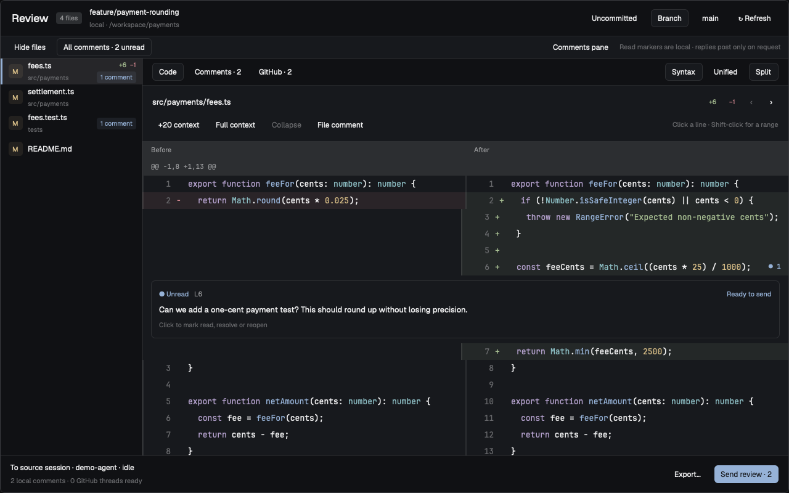
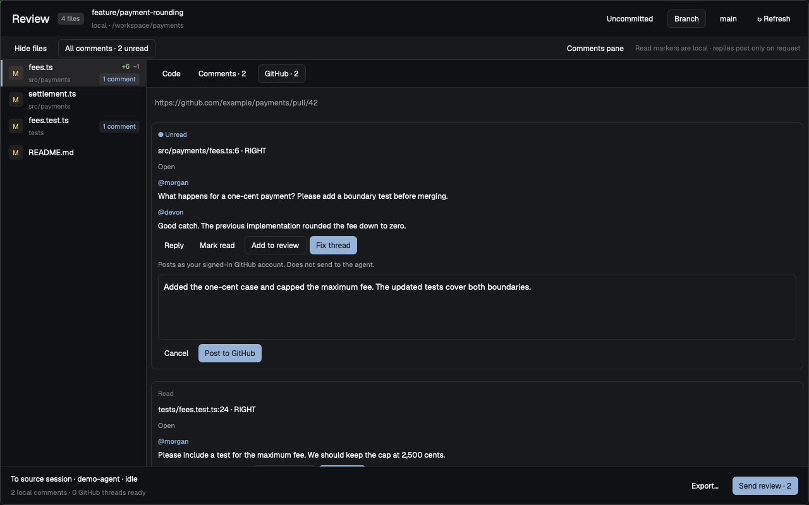
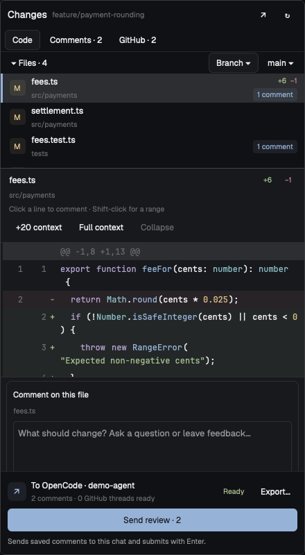

# Herdr Annotator

A native code-review mod for **[Herdr App](https://herdr.dev)**. Compare branch
or uncommitted changes in a sidebar or full review tab, leave comments on files
or lines, and send your review to the agent working in that checkout. Read GitHub
PR review threads, reply directly, or queue them for the agent to address.
Works with local and SSH worktrees.





<details>
<summary>Compact Changes sidebar</summary>



</details>

Screenshots use disposable demo data.

## Features

- Changes sidebar and a full review tab with unified or split diffs.
- Branch and uncommitted changes, local or over SSH. Auto base prefers local `develop`.
- File and line comments, read/unread markers, resolve/reopen, and export.
- Syntax coloring, expandable context, resizable panes, and large file lists.
- GitHub review threads with refresh, polling, **Fix thread**, and explicit replies.
- Saved view settings and **⌘Enter / Ctrl+Enter** to save a comment.

## Install

Requires macOS or Linux, Herdr App, herdr-core (`hc`), Git, Rust, and Python 3.
GitHub threads also need an authenticated GitHub CLI (`gh`) on the app machine.
Without `gh`, local reviews still work; the GitHub tab shows setup instructions.

```sh
git clone https://github.com/jakub-tucek/herdr-annotator.git
cd herdr-annotator
python3 scripts/install.py
```

The installer builds the Rust helper and installs the native JavaScript mod.
Remote machines need no extra installation.

To use it in the existing Changes panel, clone a layout and install into that copy:

```sh
herdr-app do layout.clone '{"name":"main","as":"my-review"}'
python3 scripts/install.py --layout my-review
```

For an existing personal layout, use its name instead. The installer backs up
changes and refuses to overwrite locally edited mod files.

## Use

Open **Changes**, select a file, and click a line to comment. Shift-click selects
a range. Save comments with the button or **⌘Enter / Ctrl+Enter**.

Click **↗** for full review. It hides the duplicate sidebar and keeps the source
checkout and agent binding. Click **Send review** to submit saved feedback to the
idle agent, then return to its session.

Comments stay on your app machine. Git and GitHub review reads do not modify the
repository. Only **Post to GitHub** posts a reply, as your signed-in `gh` account.
An unconfirmed post keeps its draft; check GitHub before explicitly retrying.
**Send review submits with Enter**; check the chat
before retrying uncertain delivery. Diff preview limits still apply.

## Development

```sh
cargo test --locked
npm test # Node.js 22+
```

See the [user guide](docs/guide.md) and [mod recipe](RECIPE.md) for details.

Capture the native demo screenshots on macOS with
`python3 scripts/catalog_screenshots.py --output <temporary-directory>`.
The fixture blocks network access, agent messages, and settings writes.

[MIT license](LICENSE).
