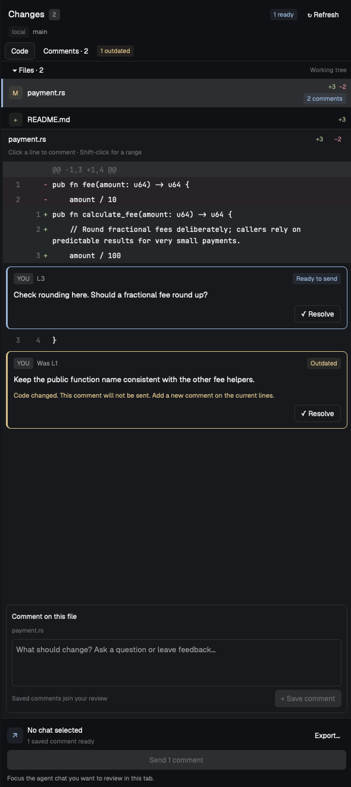

# Herdr Annotator

A native Herdr App review panel: select changed files, click source lines or
Shift-click ranges, write persistent notes, then explicitly export or submit
feedback to an idle agent through herdr-core.

## What you see

One compact Changes panel: title/branch, full-tab and refresh icons; view tabs;
Files row with Uncommitted/Branch dropdown and local base refs;
collapsible file list; file title and range-selection hint;
scrollable wrapped unified diff with old/new gutters; bordered inline note cards;
boxed multiline composer; fixed session recipient and full-width send action.
File rows separate the filename and directory, plus green/red line counts and
comment-count badges. Use theme colors and actual sidebar width, not a wide tab.
Native draggable dividers separate files, code/comments, and composer; sizes persist.
Context buttons expand unchanged lines by 20, request full context, or collapse.
The full-tab icon opens a pinned standalone review: collapsible file navigator
and wide virtualized unified/split diff with inline comments. A third comments
column is optional, off by default. The composer opens on demand.
Full reviews default to Branch and remember comparison mode, diff style, pane
visibility, unread filter, context size and widths. Base refs stay checkout-specific.
Syntax/Plain is a saved toggle. A bounded lexer colors source tokens with theme
colors without changing source text or the diff's add/delete/selection backgrounds.

Added/deleted source has green/red tints; selection has an accent gutter and
background. Ready-to-send note cards use accent borders and badges; outdated
cards use amber with an explicit exclusion explanation; sent/resolved notes have
their own status. Comments lists every file's feedback, including outdated and
no-longer-changed files. Saving and sending are separate buttons with distinct
placement. Disabled Send explains whether a draft, missing chat, busy agent or
outdated comments block it. No terminal UI or popup picker.

## How it behaves

Default to the active space's terminal checkout, with optional pinned scope props.
File notes use no range. Clicking old-only deletions selects old lines; other
source rows select new lines. Shift-click extends on the same side. Saved notes
support resolve/reopen; unsaved drafts stay in memory per context. Refresh every
15 seconds except during a draft. A changed revision requires reselection.
List all changed files, loading only selected/annotated diffs. Branch scope includes
committed and uncommitted work since merge-base; never fetch refs automatically.
Unchanged lines accept annotations; collapsing the preview preserves their anchors.

GitHub threads poll every five minutes; Refresh fetches immediately. Show replies,
outdated/resolved states, new replies and delivery receipts. Fix thread sends only
that thread; Add to review queues it with local notes. GitHub remains read-only.
Read/unread markers persist locally. Unread-only filters comment lists; new GitHub
replies become unread. Reading changes neither resolution nor delivery eligibility.
Full tabs pin the source checkout/comparison/chat. Losing that chat disables Send.
Opening full review hides the existing Changes sidebar; returning to the source
tab restores it. Respect manual sidebar toggles and do not replace a Files panel.

Bind to the current tab's focused agent session automatically. Keep that binding
when the composer takes focus; never guess between multiple chats or across tabs.
Each Send click resolves the current chat again and submits with Enter immediately,
without an extra confirmation. Disable repeat clicks while delivery is running.
Working/blocked/unreported terminals cannot receive feedback. Persist uncertain
delivery before the core call so a crash/reply loss never silently resends.
Requeue requires another explicit decision. Tests never send to a real agent.
After confirmed delivery, focus the exact recipient pane. Never focus another
chat if it disappeared, and never change focus on failed or uncertain delivery.
Cmd+Enter / Ctrl+Enter in the composer saves one comment, never sends the batch.
Plain Enter stays multiline; the save action obeys stale/offline/busy guards.

Auto branch base prefers local develop before origin/HEAD. Named base selections
are pinned; Auto clears the pin. Reset legacy origin/develop defaults to Auto,
preserve custom saved refs, and keep notes isolated by resolved comparison/base.

## Built from

- `mods/annotator/main.js`: native GPUI view, TextareaState composer, themed rows,
  context-scoped drafts, current-tab session binding, per-call async contexts;
  helpers in `review.js`.
- Rust CLI/library: `Engine::handle(Request)` with snapshot/add/resolve/export/send/github.
- Read markers: `read` for local comments and `github_read` for cached thread versions.
- `mods/annotator/full.js`: full-tab layout, deferred variable-height diff rows,
  split-side selection and paged comment cards. `list` comes from gpui-kit.
- `mods/annotator/syntax.js`: bounded pure lexical tokens; independent old/new
  multiline state, reset across hidden context gaps. No HTML or code evaluation.
- Read-only Git subprocesses; remote Git argv through `hc exec`. Local hashed
  JSON stores with exclusive locks, atomic mode-0600 writes and corruption errors.
- Exact selected-text/context anchoring; refuse ambiguity, branch mismatches,
  stale revisions, noncontiguous/out-of-preview selections.
- Mod methods: `spaces`, `panes`, `focused`, `agents`, `exec`, `home`, `props`,
  `theme`, `settings`, `shared`, `setShared`; native `v_resizable`/`resizable_panel`.
  GitHub API queries run through local authenticated `gh`, only on github.com.

## Watch out

Herdr App mods are JavaScript, not Rust dynamic libraries. Rust is a local helper;
remote cores do not load this mod. `hc send` includes Enter. The mod's `exec`
has a 30-second limit. Native checks render only the initial state; also inspect
the live panel. Anchor old/new sides separately and keep literal Git pathspecs.
The helper shares a 25-second subprocess budget across each request, including
GitHub pagination and Send. Capture drains both pipes with bounded retention;
inherited writers cannot keep it waiting indefinitely. Local process-group
cleanup does not confirm remote cancellation. Unconfirmed Send stays uncertain.
Honor documented preview limits, preserve stale notes and never overwrite
corrupt stores. Do not edit shipped mods/layouts or stage/commit review targets.

## Done when

Rust/JS tests pass; cargo fmt/clippy pass; Herdr check passes. A real review tab
shows changed files and saved inline notes. Notes survive a helper restart, move
only to unique exact context, and become outdated for modified/ambiguous anchors.
Fake-core tests cover remote reads, confirmed delivery, failure uncertainty,
duplicate prevention and busy/blocked refusal. Git index bytes stay unchanged.
Large-list tests load a file past index 100; context notes survive collapsing.
Fake-GitHub tests cover paging, caching, reply changes and read-only delivery.
