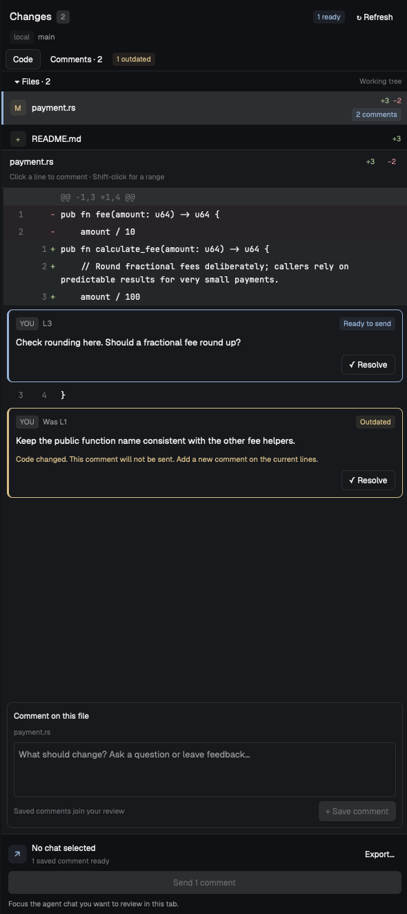

# User guide

Persistent file and line-range review notes inside **Herdr App**. A Rust engine
owns Git reads, anchoring and storage; a thin JavaScript mod draws the native
panel. Uses **herdr-core (`hc`)**, never the older Herdr TUI plugin system.

Supports branch-wide review, syntax coloring and
read-only GitHub review threads. No commit controls or full-file editor.



## Requirements

- macOS or Linux, Git, Rust stable (edition 2024).
- Herdr App with the current mod interface (`TextareaState` support).
- GitHub CLI (`gh`) authenticated on the app machine for GitHub threads.
- `hc` on the Mac/app machine's PATH for remote repos and feedback delivery.
- Existing connected core machines for remote work. Remote hosts need only Git
  and their existing core, not this binary or mod.
- Node.js 22+ for JavaScript tests; Python 3 for the development installer/tests.

## Build and install locally

```sh
cargo test --locked
npm test
python3 scripts/install.py
```

The installer builds the release binary, runs `herdr-app check`, installs
`~/.local/bin/herdr-annotator` and copies the mod to
`~/.config/herdr-app/mods/annotator`. Installed copies are used because Herdr
may not watch changes through an external development symlink. Rerun the
installer after source edits. It refuses unrelated installs or locally modified
installed source files; reconcile those changes first. Reinstalls preserve
timestamped backups. No layout, key,
agent, branch or terminal changes by default.

To use the existing Changes panel in a **personal** layout:

```sh
python3 scripts/install.py --layout task-groups
```

The usual **Changes** button then opens Annotator, beside the current chat.
This opt-in backs up the layout. Shipped layouts are refused. Herdr hot reloads
mod/layout changes; no service restart. `HERDR_APP_HOME` selects another app home.

Use **↗** in Changes to open a full review tab. This pins the source checkout/chat
and handles sidebar visibility. A bare `tab.new --mod annotator` does not supply
that source binding or enable the full presentation.

## Review

1. Open the review beside a Git checkout. The panel follows its space and live
   terminal folder. A separate review tab uses a terminal folder from its space.
2. Select a changed file. Click a source line; **Shift-click** extends a range
   on the same old/new side. Deletions use old lines; additions/context use new
   lines. The range label shows which side was selected.
3. Write a multiline note and click **Save comment**. **Whole file** clears the range.
    A line comment spans at most 200 consecutive visible source lines.
    **⌘Enter / Ctrl+Enter** in the composer saves the draft without sending it;
    plain Enter still inserts a newline.
4. Saved comments appear beneath their anchor. **Code** shows the diff; **Comments**
   lists every saved note across files. Cards show their range and status:
   **Ready to send**, **Outdated**, **Sent**, **Check delivery**, or **Resolved**.
   File badges show comment counts; outdated comments stay visible but are excluded
   from sending. The footer explains why Send is disabled instead of hiding them.
5. **Resolve** hides a note from exports/delivery; **Reopen** makes it pending
   again. Drafts stay in memory per space/folder while navigating. Saving is
   explicit; closing/reloading loses unsaved drafts, not saved comments.
6. **Export** shows selectable feedback text without sending anything.
7. The panel binds automatically to the **open agent session in the current tab**.
    Click **Send review** once. It immediately submits the saved batch using
   `hc send --if idle`, including Enter; there is no second confirmation.
   Never submits automatically or uses `--force`. No real agent receives test
   text during development checks.

The footer identifies the bound session and its status. Focusing the composer
keeps the last focused chat from that tab. With multiple chats, focus the intended
one first; another tab is never chosen automatically. Each click resolves the
current chat again. Working/blocked sessions stay bound, but sending becomes
available only when they are idle.

An unreachable machine shows a connection error with **Retry**, **Machines…**
and optional technical **Details**, not an empty checkout. The last loaded diff
stays visible in that panel, marked cached; review actions pause until a fresh
snapshot succeeds. Retry preserves drafts and requires line reselection if the
code changed while disconnected. Known-offline machines skip automatic Git
requests; an explicit Retry still probes the connection.

The helper rechecks the target's machine, live/reported/idle status and actual
Git checkout before sending. The core enforces idle status again at submission.
There is no atomic core operation combining checkout verification with send;
avoid changing the target's folder/process during delivery.

Confirmed notes remain visible as **Sent** and cannot be sent twice by accident.
After a confirmed Send, the app focuses the exact recipient session's pane/tab.
Failed or uncertain delivery never changes focus; a closed recipient is not
replaced with another chat.
A failed/lost send is **Delivery uncertain**: check the target before explicitly
requeuing the note. Delivery does not imply the agent completed or accepted the
requested code changes. Notes are never auto-resolved.

For a pinned panel, pass mod props:

```json
{
  "scope": { "repo": "/home/me/project", "machine": "server" },
  "space": "server/<space-id>",
  "tab": "server/<source-agent-tab-id>"
}
```

Use `machine: null` locally. IDs come from `herdr-app ls`; never guess them.
Optional `helper` overrides the local binary path for development.
Optional `file` chooses the initially selected changed file.
Optional `view: "comments"` starts on the comments list instead of Code.

The file list can collapse to give more room to the diff. Filenames and folders
are separate, with added/deleted-line counts. Clicking source lines highlights
the selected range and labels the bordered comment composer. Saving adds a note
to the review; the separate full-width Send action submits the saved batch.

### Comparison, context and section sizes

- **Uncommitted** compares HEAD with staged, unstaged and untracked work.
- **Branch** compares the base branch's merge-base with the current worktree,
  including committed, staged, unstaged and untracked changes. **Base…** lists
  local and remote-tracking refs; nothing fetches automatically.
  **Auto** prefers local `develop`, even if `origin/HEAD` points elsewhere or
  `origin/develop` is stale. Without local `develop`, the previous remote-default
  fallback applies. Picking a named ref pins it; choosing Auto clears that pin.
  Legacy saved `origin/develop` defaults are reset to Auto. Other saved custom
  refs stay pinned. Notes remain stored under their original comparison/base.
- All changed filenames are listed, with no 100-file cutoff. The selected file
  and files with saved comments load their diffs on demand. Line counts shown
  beside loaded files describe the visible preview, not unloaded files.
  The native file list builds only visible rows, so large lists do not exhaust
  Herdr's JavaScript render budget.
- Drag the dividers between the file list, code/comments and composer. Sizes
  persist across reloads. The file list can still collapse.
- **+20 context** expands unchanged lines around every hunk in the selected
  file. **Full context** requests the whole file, subject to preview limits;
  **Collapse** returns to three context lines. Unchanged lines accept comments.
  Saved anchors are validated with their original context even when collapsed.

The sidebar header has three rows: title/branch with **↗** and Refresh, view tabs,
then **Files** with a comparison dropdown and branch base. No duplicate scope caption.

### Full review tab

Click **↗** beside Changes to open a standalone review tab. It pins the checkout,
comparison, selected file and source chat instead of following the new tab's focus.
The default layout has a collapsible file navigator and wide diff with inline
comments. **Comments pane** toggles an optional third column; that choice persists.
Selecting lines or choosing **File comment** opens a compact composer. Clicking an
inline note opens its Read/Resolve actions. **Unified / Split** switches between a single patch and aligned Before/After
columns. Split-mode clicks anchor the actual old/new side; blank padding cannot
receive annotations. Shift-click extends a range. Diff rows wrap and render on
demand; existing preview limits still apply. Previous/next file buttons navigate
without loading every file's diff. Comments and GitHub remain available as views.

Sending stays bound to the source agent, even when another chat gains focus.
If that agent disappears, Send disables rather than choosing a replacement.
Opening full review hides the existing Changes sidebar. Returning to its source
tab restores it if it was previously open. Manual sidebar toggles in full review
are respected; a Files panel opened there is not replaced on return.

Full reviews default to **Branch**. The last Branch/Uncommitted choice, split/unified
mode, file drawer, optional comments pane, unread filter, context size and column
widths persist across new review tabs and app restarts. Base refs are remembered
per machine/checkout, never copied to an unrelated repository. The compact sidebar
keeps its own comparison state.

**Syntax / Plain** toggles lexical coloring, enabled by default and remembered
globally. It recognizes JS/TS, Rust, Python, C-like languages, JSON, YAML/TOML,
shell, SQL, CSS and HTML/XML. Keywords, strings, comments, types, functions and
numbers use theme colors; diff backgrounds and selection remain unchanged.
Old/new multiline state is separate and resets at hidden gaps. This is a small
lexer, not a full language grammar. Unsupported languages and extreme lines
stay plain. Large compact-sidebar previews also stay plain to keep rendering
bounded; full review colors only the visible rows.

### Read and unread

Local comments and GitHub threads have **Mark read / Mark unread** controls.
**All comments / Unread only** filters the comment lists. These markers persist
on the app machine and are shared by the sidebar and full tab after refresh.
Reading never resolves a comment, marks it delivered, or excludes it from Send.
GitHub read markers apply to an exact thread version; new replies become unread.
No read action writes to GitHub. New comments and older stores start unread.

### GitHub review threads

The **GitHub** tab discovers the open PR matching this checkout's branch and
origin/upstream repository on github.com. It uses local `gh` credentials,
polls every five minutes, and **Refresh** forces a new fetch. Remote checkouts
still use the app machine's `gh`; no helper installation there is needed.

**Fix thread** sends only that thread to the open idle agent session.
**Add to review** queues it alongside local comments for one-click batch
delivery or export. Threads include reviewer replies and stored diff context.
New replies require reselection; resolved, incomplete, sent or uncertain thread
versions cannot be sent. Failed refreshes preserve the last result with an
error and prevent sending threads. Nothing posts replies or resolves threads.

## Storage and safety

Saved notes live on the **app machine** under
`$HERDR_ANNOTATOR_STATE_DIR`, else `$XDG_STATE_HOME/herdr-annotator`, else
`~/.local/state/herdr-annotator`. No writes to the reviewed repository, its Git
index, refs or remote host. JSON files are mode `0600`, atomically replaced and
protected by per-worktree locks. Corrupt/incompatible stores fail without being
overwritten. Back up that directory to preserve saved reviews.

Review identity is machine + checkout root + comparison/base. Different worktrees are isolated;
comments additionally record the branch. Line anchors retain selected text and
nearby diff context. They move only to a unique exact match, otherwise show as
**Outdated**. Renames are displayed as delete/add; notes are not guessed across
renames, branch switches or hidden hunks. File notes remain attached while that
file is changed on the same branch. Feedback excludes outdated, resolved,
sent and uncertain notes.

Git runs without a shell, optional locks, external diff drivers or textconv.
Paths use literal pathspecs, including filenames with brackets. Remote reads
run as argv commands through `hc exec`; nothing installs on the remote host.
The only program-input write is an explicit click on Send.

## Limits

- Working tree against HEAD or branch merge-base; unborn repos support Uncommitted.
  No arbitrary commit-range/last-turn scopes yet.
- No file-count cutoff. Git metadata output is capped at 8 MiB and fails clearly
  rather than silently cutting the list. 2 MiB total preview, 512 KiB diff output,
  2,000 rows/file and 8 KiB/line. Limits show a warning; file notes still work.
- Binary/mode-only/submodule entries are metadata-only. UTF-8 paths/text only;
  unsupported command output fails with an error instead of lossy anchors.
- 500 notes/worktree, 16 KiB/note, 64 KiB feedback batch. No delete/archive UI
  yet; resolved notes stay in history.
- Long code lines wrap in the panel, not edit or truncate the source. This is a
  review panel, not an editor. Export includes the exact anchored source text.
- Automatic Git refresh every 15 seconds, paused while a draft is nonempty.
  Save/export/send recompute the diff and reject an obsolete displayed revision.
  Herdr limits mod helper calls to 30 seconds; large/slow remote reviews can
  time out. No background daemon or automatic retries.
- Notes are local to this app machine, not synchronized to other computers.
- GitHub supports github.com only, up to 200 threads, about 500 replies/thread,
  16 KiB/comment and 32 KiB stored snippet. Truncated threads cannot be sent.
  Export/send rechecks selected thread fingerprints against GitHub.

## Interface

The Rust engine exposes one JSON request per invocation:

```sh
herdr-annotator request '{"op":"snapshot","scope":{"repo":"/path/to/checkout","machine":null}}'
```

Or pipe the same JSON to `herdr-annotator request`. Replies are
`{"ok":true,"data":...}` or `{"ok":false,"error":"..."}` with nonzero exit.
Operations: `snapshot`, `add`, `resolve`, `read`, `export`, `send`, `github`, `github_read`.
The engine's public Rust interface is
`Engine::handle(Request)`, also used by integration tests.

## Development

```sh
cargo fmt --check
cargo clippy --locked --all-targets -- -D warnings
cargo test --locked
npm test
herdr-app check "$PWD/mods/annotator"
python3 scripts/native_stress.py --files 5000
python3 scripts/native_stress.py --full --files 5000 --rows 2000
```

Rust tests use disposable repositories and fake core commands. They exercise
persisted notes, anchoring, literal paths, symlinks, parallel writes, worktree
isolation and delivery failure handling without contacting a real agent.

Herdr's check covers initial rendering only. Inspect `herdr-app status` and a
`herdr-app shot` in a review tab after UI edits. Keep test feedback away from
live agents. Tests do not send feedback to real agents.

For a visual test with disposable data and isolated note storage:

```sh
python3 scripts/native_fixture.py --states --open
python3 scripts/native_fixture.py --full --open
```

This opens one preview tab, creates no terminal/agent, and never sends feedback.
Close only that preview tab afterwards. `preview.png` shows this fixture, not
private repository contents.
